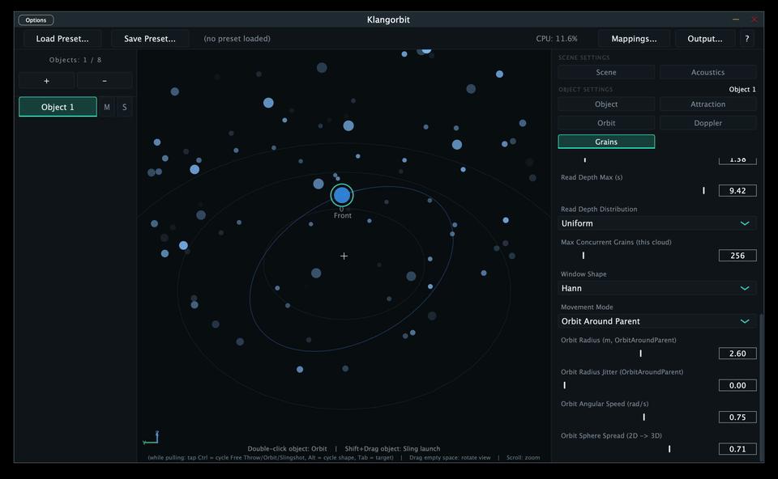

# Klangorbit



Object-based Ambisonics encoder with a live trajectory/physics engine:
instead of automating position with envelopes or curves, you give sound
objects mass, velocity, gravity, and momentum, and let their motion
emerge from that. An internal decoder renders straight to a selectable
output format -- no external decoder required for most formats.

The whole simulation (physics, panning, grain/delay spawning) runs on
its own timer inside the processor, independent of whether an editor
window is open -- closing the editor never pauses anything.

## Contents

- [Signal flow](#signal-flow)
- [Build (macOS)](#build-macos)
- [Windows build](#windows-build)
- [Testing with Reaper + SPARTA/IEM](#testing-with-reaper--spartaiem)
- [Output formats: channel layouts and standards](#output-formats-channel-layouts-and-standards)
- [Binaural (HRTF) output](#binaural-hrtf-output)
- [Objects, motion physics, and the parameter panel](#objects-motion-physics-and-the-parameter-panel)
- [3D camera view](#3d-camera-view)
- [Sling launch gesture](#sling-launch-gesture)
- [Gamepad control](#gamepad-control)
- [Controller mapping](#controller-mapping)
- [MIDI / OSC control](#midi--osc-control)
- [DAW automation](#daw-automation)
- [Acoustic propagation](#acoustic-propagation-doppler-delay-air-absorption-directivity)
- [GrainCloud: granular synthesis](#graincloud-granular-synthesis)
- [DelayInstance: multi-tap delay with feedback](#delayinstance-multi-tap-delay-with-feedback)
- [Modifier stack](#modifier-stack)
- [Agitation: per-parameter random modulation](#agitation-per-parameter-random-modulation)
- [Snapshots: capture/recall a whole parameter set](#snapshots-capturerecall-a-whole-parameter-set)
- [GUI design](#gui-design)
- [Project structure](#project-structure)
- [Known limitations / next steps](#known-limitations--next-steps)
- [License](#license)

For deep "why was it built this way" rationale, bug postmortems, and the
full feature-by-feature history, see `CHANGELOG.md` -- this README stays
to "what it is, how you use it."

## Signal flow

Per object, up to three sources can reach the encoder -- the dry object
itself, and (mutually exclusive) either its grain cloud or its delay:

```
Live input (per object)
        |
        +------------------+------------------+
        v                  v                  v
  SoundObject         GrainCloud          DelayInstance
  (dry signal)         (optional)          (optional --
        |            grain pool, own      mutually exclusive
        v            movement modes,      with GrainCloud)
  Propagation-        own filter +        recirculating buffer
  Processor:          modifier stack       + feedback, own
  delay, Doppler,     (per grain)          taps + modifier
  air absorption,                          stack (per tap)
  directivity
        |                  |                  |
        +------------------+------------------+
                            |
                            v
                   AmbisonicsEncoder
        (every source above arrives as its own mono
         signal with its own gains; grains/taps skip
         PropagationProcessor entirely)
                            |
              Output Format decides what's next:
                            |
        +-------------------+-------------------+
        v                   v                   v
  raw Ambisonics      Stereo / Binaural    Quad / Octophonic /
  direct SH encode,   SH encode (order 3)  Circular Array / 5.1 /
  no decode step      -> AmbisonicsDecoder  7.1 / Atmos-bed:
                       (HRTF convolution     direct VBAP pan,
                        or 2-point decode)   no SH involved
        |                   |                   |
        v                   v                   v
        DAW / Max/MSP / SPARTA / IEM Suite, or straight to speakers/headphones
```

GrainCloud's and DelayInstance's own per-voice/per-tap filter plus the
shared Modifier stack (Gain/Time Offset/Filter/Pitch/Movement/Spatial
Offset -- see [Modifier stack](#modifier-stack)) are both folded into
the single "own filter + modifier stack" line above.

## Build (macOS)

Requirements: CMake >= 3.22, Xcode Command Line Tools.

```bash
# Get JUCE as a submodule (recommended, otherwise CMake re-downloads it on every clean build)
git submodule add https://github.com/juce-framework/JUCE.git JUCE

mkdir build && cd build
cmake .. -DCMAKE_BUILD_TYPE=Release
cmake --build . --config Release
```

Result: `Klangorbit.vst3`, `Klangorbit.component` (AU), and the
Standalone app in `Klangorbit_artefacts/`. Both plugin formats are
copied automatically to their system-wide plugin folders. The AU folder
isn't world-writable by default on a fresh macOS install, so run this
once before the first AU install:

```bash
sudo chmod 777 "/Library/Audio/Plug-Ins/Components"
```

A few build facts worth knowing:

- The AU registers as a plain Effect (`aufx`), not a Music Effect, so it
  actually shows up as insertable in Logic Pro's track list.
- In Logic Pro specifically, input/output channel counts are narrower
  (negotiated per track, up to 7.1 in / 7.1.4 out) than in any other
  host or in VST3/Standalone, which always expose a fixed, full-width
  36-channel bus. Only the 9 Output Formats with both a named layout and
  <= 12 channels are selectable in Logic; the dropdown greys out the
  rest. See [Known limitations](#known-limitations--next-steps).
- Every format now starts up in Stereo output by default (not raw
  Ambisonics) -- switch Output Format manually if you need B-format.

## Windows build

Requirements: CMake >= 3.22, Visual Studio 2022 (Desktop development
with C++ workload), Windows 10 SDK (for XInput gamepad support).

**No Windows machine available?** `.github/workflows/windows-build.yml`
builds this automatically on a hosted Windows runner on every push
(or manually via the Actions tab) -- `Klangorbit.vst3`/`Klangorbit.exe`
are attached as downloadable artifacts, no local Windows setup needed.

```bash
git submodule add https://github.com/juce-framework/JUCE.git JUCE

mkdir build && cd build
cmake ..
cmake --build . --config Release
```

Result: `Klangorbit.vst3` and the Standalone `.exe` -- no AU (Apple-only
format). The VST3 copies to `%ProgramFiles%\Common Files\VST3`, which
needs an elevated build (run from an Administrator shell) or a manual
copy. Gamepad support uses XInput instead of macOS's GameController
framework (Xbox-compatible controllers, same scope as macOS). Everything
else is plain, portable JUCE C++ with no platform-specific code.

## Testing with Reaper + SPARTA/IEM

1. Start the plugin/standalone app, connect a live input to Input 0.
2. Default Output Format is Stereo (audible immediately). Switch to 3rd
   Order Ambisonics (toolbar -> "Output...") to route to SPARTA AmbiBIN
   or the IEM BinauralDecoder instead -- every other format sends
   already-decoded audio straight out, no external decoder needed.
3. Drag object 0 with the mouse -> direction changes in playback.
4. Double-click an object to start an orbit around the origin.
5. Drag an object quickly and release -> throw gesture; it keeps moving
   and slows via `damping`/`dragCoefficient`, reflecting/wrapping/
   absorbing at the room boundary (`roomSize`).
6. Click an object (no drag) to select it -- its parameters appear in
   the panel on the right. "+ Object"/"- Remove Object" (object list,
   left side) activate/deactivate slots.
7. Shift+drag an object -> sling launch gesture (see its own section
   below for the full set of modifier keys).
8. Drag on empty space -> orbits the camera; scroll to zoom.
9. Click a row in the object list (left) to select that object without
   needing to hit it with the mouse directly.

## Output formats: channel layouts and standards

16 formats total, in toolbar -> "Output..." dropdown order. Full speaker
angles/channel order are verified against `Source/SpeakerLayouts.h`.

**Decode method:** Quad/Octophonic/Circular Array/5.1/7.1/all four
Atmos-bed layouts pan each object directly to real speakers via VBAP.
Stereo uses a simple 2-point Ambisonics decode. Binaural and the raw
Ambisonics outputs are unrelated to either (see their own sections).

| Format | Layout | Standard |
|---|---|---|
| Stereo | L/R ±30° | ITU-R BS.775-4 |
| Binaural (HRTF) | not a loudspeaker layout | see [Binaural](#binaural-hrtf-output) |
| Quad | L/R ±45°, Ls/Rs ±135° | conventional, not ITU |
| Octophonic | 8 fixed speakers, ±22.5°/±67.5°/±112.5°/±157.5° | no formal standard found; matches Blue Ripple Sound's "O3A Decoder -- Octagon" |
| Circular Array | 4-24 speakers, evenly spaced | pure geometry, no naming convention needed |
| 5.1 | L/R ±30°, C 0°, Ls/Rs ±110° | ITU-R BS.775-4 |
| 7.1 | L/R ±30°, C 0°, side ±90°, rear ±135° | ITU-R BS.775-4 |
| 5.1.2/5.1.4/7.1.2/7.1.4 | matching bed + height channels at 45° elevation | ITU-R BS.2051-2 (permitted sectors; exact angles are Dolby's commonly published guidance) |
| 1st-5th Order Ambisonics | raw B-format, 4/9/16/25/36ch | ACN/SN3D, AmbiX-compatible |

Every named layout uses JUCE's own `AudioChannelSet`s, so a host sees
the channel stream order it already expects for that format name.

## Binaural (HRTF) output

Decodes straight to 2-channel headphone audio inside the plugin -- a
real HRTF convolution, not the plain 2-speaker Stereo format. The
summed Ambisonics bus is decoded to a dense 50-point virtual speaker
array, then each virtual speaker is convolved through its own measured
left/right head-related impulse response and summed to the output. Loudness-calibrated against the other output formats (`BinauralDecoder::calibrateOutputGain()`) so switching into/out of Binaural doesn't jump in level. See `BinauralDecoder.h` for the full breakdown.

A dataset picker appears in the Output window whenever Binaural is
selected:

- **KEMAR** (default) -- Gardner & Martin, MIT Media Lab.
- **SADIE II -- D1 (KU100)** -- University of York.
- **KU100 -- 2° Grid (TH Köln / Bernschütz)** -- the densest of the
  three, full-sphere 2° grid.
- **Custom SOFA file...** -- import any AES69/SOFA HRTF measurement.

All three bundled datasets need attribution when redistributed -- see
`THIRD_PARTY_LICENSES.md`. Switching datasets rebuilds the decode matrix
and all 100 convolution engines immediately (expect a brief pause,
longer for the larger SADIE II/KU100 files). The dataset choice is
plugin-instance state, not saved in a preset.

## Objects, motion physics, and the parameter panel

- **Dynamic object count.** Only object 0 is active at startup. "+
  Object"/"- Remove Object" (object list, left side) activate/
  deactivate individual slots, up to 8. The audio bus itself stays fixed
  at 8 channels either way.
- **Objects brake to a stop.** `maxVelocity` caps speed,
  `dragCoefficient` is a real velocity-proportional braking force (on
  top of `damping`), `velocitySnapThreshold` hard-stops very slow
  residual motion.
- **Room boundary.** `SceneSettings::roomSize` (spherical, shown as a
  red wireframe sphere), with `reflect` (+ per-object `restitution`),
  `wrap`, or `absorb` behavior.
- **n-body refinement:** `forceExponent`/`minDistance`/`maxRange` are
  per object; `attractionPulseRate`/`-Depth` periodically modulate
  attraction strength.
- **Orbit extensions:** tilted orbit plane (`orbitPlaneNormal`),
  elliptical orbits (`orbitEccentricity`, simplified) with a rotatable
  major axis (`orbitOrientation`), shrinking/growing orbits
  (`orbitDecay`), orbiting another moving object (`orbitReferenceObjectId`).
- **Force field & time scale:** `globalField` ("Force Field" in the
  panel -- affects Impulse-mode objects only, unrelated to
  `windVector`/"Propagation Wind," which only affects sound) and
  `timeScale` (fast-forward/slow-motion).
- **Parameter panel** (right side): edits all parameters of the
  selected object plus scene parameters, writing directly to the live
  engine. Full field reference in `Presets/schema/README.md`.
  **Position** is a real, host-automatable parameter -- setting it
  switches the object into Manual mode, same as a mouse drag.
  **Momentum** (default on) governs only whether a fast mouse-release
  throws the object (Impulse mode) or leaves it in place.
- **Object list** (left side): lists active objects, click to select.
  Each row has its own **M**(ute)/**S**(olo) -- the only place these
  are exposed. Own `muted` always wins over `soloed`; soloing is
  non-exclusive (several objects can be soloed together). Applies to an
  object's GrainCloud too. Fades over ~20ms, never clicks.

## 3D camera view

A single orbit-camera projection (`Source/Camera3D.h/.cpp`) around the
world origin -- no OpenGL, hand-written perspective projection drawn
with plain `juce::Graphics`. The default framing (looking straight
down) matches the project's old fixed top-down view exactly.

- **Orbit/zoom.** Drag empty space to rotate azimuth/elevation; scroll
  to zoom (1-150m range, multiplicative so it feels consistent at any
  distance).
- **Dragging objects** happens on the ground plane (z=0) via a camera
  ray cast. **Alt+drag moves height (Z)** instead -- the only way to
  reach the third axis with the mouse.
- Objects/grains are depth-sorted and drawn back-to-front; size and
  opacity scale with camera distance.
- The room boundary renders as a shaded, translucent sphere (toggle:
  `showRoomBoundary`, "Show Boundary" -- purely cosmetic, the physical
  boundary still applies while hidden).
- A small on-screen gesture reminder, a short fading movement trail per
  object, an orbit-path preview for objects in Orbit mode, and a
  stronger highlight while actively dragging/slinging round out the
  view. Distinct per-object colors (golden-ratio hue stepping) stay
  visually distinguishable regardless of object count.

## Sling launch gesture

Shift+drag+release on an object -- a catapult-style alternative to the
plain throw gesture, for launching with a precisely aimed direction and
strength instead of however fast the mouse moved.

- **The gesture.** Shift+click to grab an object; its position freezes
  at that anchor point while a visual marker follows the cursor,
  connected by a bow line. The pull vector (anchor minus release point)
  sets both direction (opposite the pull) and strength (proportional to
  pull distance). Pulling less than ~15cm cancels the shot.
- **Three launch modes**, cycled mid-gesture by tapping **Ctrl**:
  - **Free Throw** (default) -- the existing throw/Impulse physics,
    aimed by the pull instead of release velocity.
  - **Orbit Shot** (tap **Alt** to cycle circular/elliptical shapes) --
    launches directly onto a scripted ellipse/circle, sized by pull
    distance, oriented by pull direction, spin direction derived from
    the gesture's own geometry.
  - **Slingshot** -- a real, physics-based gravity-assist toward
    another object (the same inverse-square force law as Attraction),
    producing either a deflected flyby or a captured orbit depending on
    approach speed/distance/target mass.
- **Tab** cycles which other active object Orbit Shot centers on, or
  Slingshot targets (and back to "Center" first). Only meaningful while
  the gesture is active.
- A live, dashed preview (distinct from the solid bow line) shows the
  actual predicted result for whichever mode is active -- a straight
  line for Free Throw, the real ellipse for Orbit Shot, a forward-
  simulated curve for Slingshot -- updating as you drag, and
  disappearing the instant you release.

## Gamepad control

Connect a controller (macOS GameController framework, or Windows
XInput). Every control has a sensible default binding, individually
overridable via Learn mode (see [Controller mapping](#controller-mapping)):

| Control | Default behavior |
|---|---|
| Left stick | Rate-controls the selected object's position on the ground plane; centering the stick stops it immediately. |
| Right stick | Orbits the camera view (editor only). |
| D-pad Up/Down | Zooms the camera in/out (editor only). |
| D-pad Left/Right | Cycles the selection to the next/previous active object. |
| Button A | Activates the next inactive object and selects it. |
| Button B | Deactivates the currently selected object. |
| Button Y (hold) | Aims a Free Throw -- left stick sets direction/strength, release fires. |
| Left Shoulder (hold) | Aims an Orbit Shot the same way. |
| Right Shoulder (hold) | Aims a Slingshot the same way, toward the first other active object. |

Button X has no built-in behavior -- free for a Learn-mode binding.
Only one controller is read at a time. An optional inertia mode and the
deadzone/response-curve tuning exist in code but have no UI toggle yet.

## Controller mapping

Open **Mappings...** in the toolbar to bind any gamepad, MIDI, or OSC
control to any parameter: pick a **Target parameter**, press **Learn**,
then move the control you want to drive it. The binding list shows
every current mapping with its own **Remove**; **Load/Save Profile...**
save the whole binding set as its own file, independent of scene
presets (`MappingProfiles/schema/README.md`).

The target-parameter dropdown only offers scene-wide and "whichever
object is currently selected" parameters, not one specific object
regardless of selection (possible only by hand-editing a saved profile).

**Paging:** hold the control shown under "Paging modifier" (default:
left trigger) to unlock a second layer of bindings -- the same stick
can drive one parameter normally and a different one while held.

## MIDI / OSC control

Two more input sources on the same canonical layer as the gamepad --
bind either through the same **Mappings...** / Learn-mode workflow, no
separate MIDI-Learn or OSC-Learn step.

- **MIDI:** Control Change, Note On/Off, and Pitch Bend are all
  bindable; works automatically once the host routes MIDI to the
  plugin.
- **OSC:** listens on UDP port **9000** by default (matches TouchOSC).
  A normalized 0..1 control binds as continuous; a bare trigger message
  binds as a button.
- No UI yet for changing the OSC port or showing MIDI/OSC connection
  status.

## DAW automation

Separate from, and complementary to, the gamepad/MIDI/OSC mapping
above: every registered parameter is also exposed as a real,
host-automatable parameter in AU, VST3, and Standalone alike -- 589
parameters total, grouped in the host's parameter picker as "Object
1".."Object 8" (subgrouped by category) plus one "Global" group.

- Automatable: the same fields Controller Mapping exposes for a
  specific object slot or globally. Not automatable: "whichever object
  is currently selected" bindings (no stable target), enum-valued
  settings, and most runtime physics state. **Position is the one
  exception** -- automating it also switches the object into Manual
  mode, same as a mouse drag.
- Writing automation genuinely changes the sound -- same fields the
  parameter panel/gamepad/MIDI/OSC already read and write.
- Manual tweaks in Klangorbit's own controls are **not** themselves
  recorded as host automation.
- Session save/reload in the host preserves the whole scene.

## Acoustic propagation: Doppler, delay, air absorption, directivity

Runs in `PropagationProcessor`, per active object, before Ambisonics
encoding.

- **Delay and Doppler are one mechanism.** A per-object variable-length
  delay line tracks `distance / effectiveSpeedOfSound`; reading it
  through a smoothly time-varying delay produces the correct Doppler
  pitch shift as a side effect, no separate pitch-shifter.
  `dopplerFactor` scales only the pitch-shift strength (0 = none, 1 =
  physically correct); the actual latency always stays anchored to the
  true distance.
- **`speedOfSound`** (default 343 m/s) is deliberately independent of
  `temperature` -- drifting it from the physical value is an
  intentional creative tool for exaggerated Doppler/delay.
- **Air absorption** is a simplified one-pole lowpass derived from
  distance/temperature/humidity/pressure -- captures the general trend,
  not a full ISO 9613-1 implementation.
- **Propagation Wind** (`windVector`) shifts the effective speed of
  sound directionally -- affects sound propagation only, never object
  movement (that's `globalField`/"Force Field").
- **Directivity** (omni/cardioid/figure-8 + `sourceOrientation`)
  computes an angle-dependent gain between facing direction and
  listener.

## GrainCloud: granular synthesis

Optional, per object, off by default. Multiplies an object's live input
into many independently-moving grains, each with physics-based (not
purely random) movement.

- **Ring buffer + windowed playback.** Every active object continuously
  records into its own ring buffer; a spawned grain reads a short,
  Hann-windowed burst from it, with its own pitch (`pitchJitter`) and
  start-position offset (`positionJitterInBuffer`).
- **Pitch Jitter Mode:** `Random` (continuous, uniform +/- playback-rate
  deviation) or `Scale` (quantizes onto a chosen scale -- 13 standard
  interval sets, including the "Acoustic"/overtone scale).
- **Read-depth range/distribution** (`grainReadDepthRangeMin/Max/
  Distribution`) lets grains reach deliberately far into a buffer's
  past (up to 10s), independent of the small de-click offset above.
- **Single-shot grain model:** `grainDuration` is both the audio
  envelope and movement lifetime; `grainRate` controls spawn frequency,
  independently.
- **Voice stealing.** `maxConcurrentGrains` caps simultaneous grains;
  once hit, the oldest active grain gets a short forced fade-out and
  its slot is reused, so the spawn schedule never stalls.
  **Generation mode** (`Emitter`, the default continuous spawn, vs.
  `Group`, a whole burst of `groupSize` grains per interval with
  optional per-grain start-delay spread) controls how new grains enter
  that schedule in the first place.
- **5 movement modes:** `RandomWalk`, `Bounce` (elastic reflection,
  `boundaryRadius`/`restitution`), `RadialExplosion` (`initialSpeed` +
  `acceleration`), `OrbitAroundParent` (around the parent's live
  position, `orbitSphereSpread` tilts individual grain orbit planes),
  `AttractRepelSiblings` (n-body force within the same cloud only).
- **Per-parameter jitter** on `grainRate`/`grainDuration`/
  `boundaryRadius`/`initialSpeed`/`orbitRadius`, all usable at once.
- **Per-grain filter** (off by default) -- a shared multi-mode resonant
  filter (`VoiceFilter.h`), cutoff/resonance randomizable per grain at
  spawn, with optional continuous drift.
- **Optional per-grain Doppler** (off by default) -- a cheap
  approximation, scaled by the parent's own `dopplerFactor`.
- **Global spawn budget** is shared fairly across every object's cloud,
  proportional to each cloud's own setting, not first-come-first-served
  -- watch the toolbar's CPU meter when raising limits.
- Active grains render as small, fading dots around their parent object
  in the scene view; the "Grains" parameter-panel category exposes all
  cloud-level parameters.

## DelayInstance: multi-tap delay with feedback

Optional, per object, off by default, **mutually exclusive with
GrainCloud** on the same object (the UI greys out whichever toggle
isn't already on). A genuinely separate spatial sound source: taps read
from a buffer that recirculates its own past output, so echoes actually
decay over repeated passes, unlike a grain's dry re-read.

- **One recirculating buffer, multiple read taps.** `numTaps` (1-8)
  taps exist continuously, tap *i* reading `delayTime*(i+1)` seconds
  back into the same buffer -- not independent per-tap feedback paths.
- **Feedback damping** (`feedbackDamping`) darkens the recirculating
  signal via a shared lowpass filter, the classic "repeats get duller"
  tape-delay character. `delayTimeJitter` randomizes each tap's own
  multiple for a less metronomic rhythm.
- **Spatial taps** sit evenly around a circle (`tapSpreadRadius`)
  centered on the parent's live position; `tapOrbitAngularSpeed`
  optionally rotates the whole ring.

## Modifier stack

Optional, per source (one independent stack each for GrainCloud and
DelayInstance), empty by default. An ordered, reorderable list of up to
8 modifier slots, stackable including several of the same type, applied
on top of everything above -- coexists with (doesn't replace)
GrainCloud's own dedicated per-grain filter.

- **Gain** (multiplier) and **Time Offset** (seconds) are commutative --
  multiple slots simply multiply/sum, regardless of stack order.
- **Filter** reuses the same per-voice filter module, one independent
  instance per slot, cascaded **in stack order** -- the one case where
  reordering is audible.
- **Pitch** (semitones) is GrainCloud-only -- a delay tap is a
  continuous readback of an already-recirculating signal, genuinely
  pitch-shifting it would need a whole separate resampler.
- **Movement** adds an extra Linear (constant speed/acceleration along
  a random direction) or Rotating (around a random axis) drift on top
  of whatever the voice's own primary movement already does --
  additive, not a second movement engine. Multiple Rotating slots (or
  one mixed with anything else that moves the voice) compose in stack
  order; purely-Linear ones stay order-independent.
- **Spatial Offset** shifts where a voice starts, for its whole life, in
  one of five shapes: Sphere, Spherical Shell, Ring, Line, or Cuboid.
- Every value is a full randomizable parameter (base/spread/
  distribution, including snapping onto a discrete value set).
- Edits to an existing slot reach already-running delay taps live (taps
  have no "respawn" moment the way grains do).

## Agitation: per-parameter random modulation

A toggleable random wobble around whatever value a parameter currently
has, available for almost any parameter in the plugin via a dedicated
"Agitation" category in the parameter panel (grouped by the parameter's
own category, each row collapsed to just an Enabled toggle until
switched on).

- **Amount/Rate/Smoothing** control the wobble's depth, how fast it
  pulls back toward the value it had when switched on, and how smooth
  the underlying randomness is.
- **Tempo Synced** ties Rate to a musical note division instead of a
  fixed number, using the host's own tempo when available or a
  Standalone-only BPM fallback (Scene category) otherwise.
- Turning a row off and back on picks a fresh center point from
  wherever the parameter is at that moment.
- Persisted as part of the scene preset; doesn't bump the preset schema
  version.

## Snapshots: capture/recall a whole parameter set

A "Snapshots..." toolbar button opens a standalone window to capture
the current value of (almost) every parameter as a named file, and
recall it later -- separate from both scene presets and controller
mappings, with its own file format (`Snapshots/schema/README.md`).

- Tick/untick categories to control what gets captured (all ticked by
  default).
- **Load/Save Snapshot** round-trip one snapshot through its own file;
  loading recalls it immediately.
- **Randomize** (acting on whatever was just loaded/saved): a
  Strength-scaled random nudge per parameter ("Randomize Variant"), or
  a full-range redraw ignoring the snapshot's own values entirely
  ("Randomize Everything").
- **Morph**: load two snapshots as "A"/"B" (not auto-recalled), then a
  Morph slider (0 = pure A, 1 = pure B) with its own Smoothing slider
  soft-crossfades every parameter common to both.

## GUI design

Dark, cyan-accented "sci-fi HUD" look, applied uniformly:

- `Source/UiTheme.h` is the single source of truth for every colour/
  spacing value; `SciFiLookAndFeel` applies it once at the top level so
  every child component inherits it automatically.
- Each panel (toolbar, object list, parameter panel) paints its own
  background plus a hairline border, so the layout reads as distinct
  regions.
- Per-object colours stay within a blue -> violet -> magenta hue band,
  so no object colour collides with the cyan selection ring or the
  red/amber Mute/Solo indicators.

## Project structure

```
Klangorbit/
  CMakeLists.txt
  CHANGELOG.md          <- code versioning (SemVer) + full feature rationale/history
  Assets/
  Source/                <- C++ code
  Tools/                  <- verify_*.cpp CLI test binaries, no GUI/audio device needed
  Presets/
    schema/README.md     <- preset format, own schemaVersion
    factory/ user/        <- curated vs. own scenes
  MappingProfiles/
    schema/README.md      <- controller-mapping profile format, own schemaVersion
    factory/ user/
  Snapshots/
    schema/README.md      <- snapshot format, own schemaVersion
    factory/ user/
  Docs/
    WORKFLOW.md           <- branch/tag/release conventions
    UserGuide.md           <- end-user-facing feature guide
    experiments/            <- session logs for interesting sound findings
  JUCE/                    <- submodule, not checked in
```

Code version (CHANGELOG/SemVer), preset schema version, mapping-profile
schema version, and snapshot schema version are four separate,
independently-moving version counters -- each one covers a concern that
changes on its own timeline (see each format's own README for why).

## Known limitations / next steps

- **Windows build is CI-verified only** -- compiles and passes the full
  automated test suite on a hosted runner, but hasn't been used by hand
  on a real Windows machine or with a physical XInput controller.
- **3D camera and gamepad direction conventions are unverified by
  hand** -- mathematically covered by tests, but the actual drag/zoom/
  stick feel hasn't been tried on real hardware in this environment and
  may need a one-line sign flip if it feels inverted.
- **Mapping-panel "profile status" is cosmetically wrong at startup** --
  the default mapping profile loads silently before any UI exists to
  show it, so the status line reads "(no profile loaded)" even though
  one (currently empty) was loaded.
- **Binding one specific object regardless of selection** needs
  hand-editing a mapping profile's JSON -- no UI path for it.
- **VST3/Standalone's fixed 36-channel output bus** has not yet been
  re-confirmed by the reporting user's own Max/MSP/Reaper setup after
  the fix (see `Tools/vst3_bus_probe.cpp` for the automated check).
- **Circular arrays (Octophonic, Circular Array) are horizontal-only**
  -- a property of a flat speaker ring, not a decoder limitation.
- **Binaural CPU cost is unmeasured on real hardware**, and interaural
  delay (ITD) is not applied yet -- only amplitude/spectral HRIR cues.
- **The AU in Logic Pro's actual insert UI is unverified end-to-end** --
  confirmed correct at the `auval` protocol level only.
- **Air absorption is a simplified approximation**, not ISO 9613-1
  accurate.
- **n-body attraction is untested with many simultaneous attractors.**
- **No object-object collision** (objects pass through each other).
- **No audio-reactive coupling** (e.g. attraction/orbit speed modulated
  by input level) -- would need a new audio-thread-to-message-thread
  data path that doesn't exist yet.
- **`orbitEccentricity` is a simplified approximation**, not a
  focus-based Kepler orbit.
- **GrainCloud grains skip acoustic propagation entirely** (no
  per-grain Doppler/delay/air absorption/directivity) -- only the
  parent object's own dry signal goes through `PropagationProcessor`.
- **GrainCloud window shape is Hann only** -- no alternative envelopes
  yet.
- **DelayInstance's taps aren't shown in the 3D scene view**, and each
  tap's own filter/resonance isn't individually exposed (only the
  shared feedback-path damping filter is, by design).

## License

GPL-3.0 -- see `LICENSE`. Third-party dependencies (JUCE, libmysofa) and
bundled HRTF datasets have their own separate licenses/attribution
requirements -- see `THIRD_PARTY_LICENSES.md`, in particular the JUCE
entry for why this project's own license is GPL-3.0 specifically (JUCE
itself is used under its AGPLv3 option, not a commercial JUCE license).
